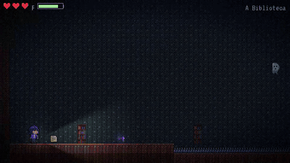
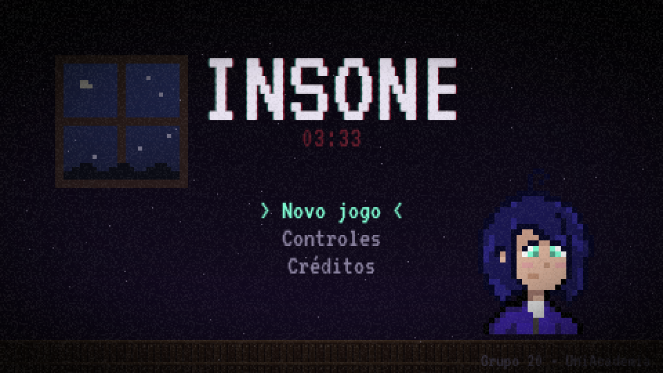
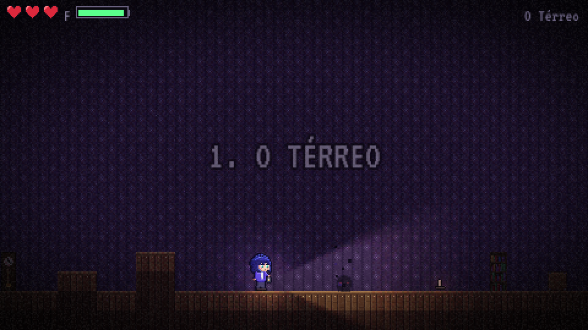
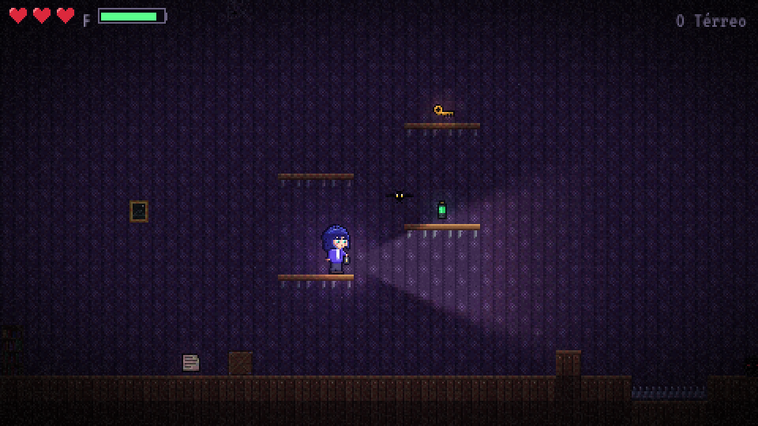
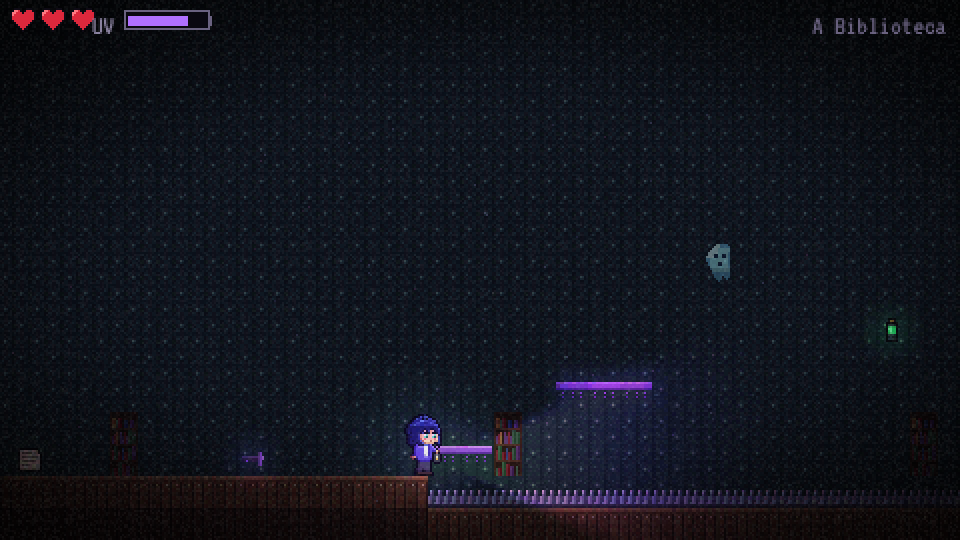
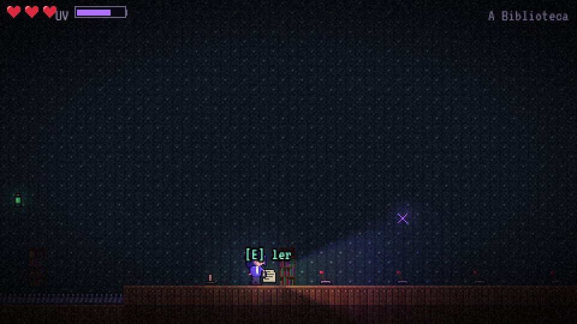
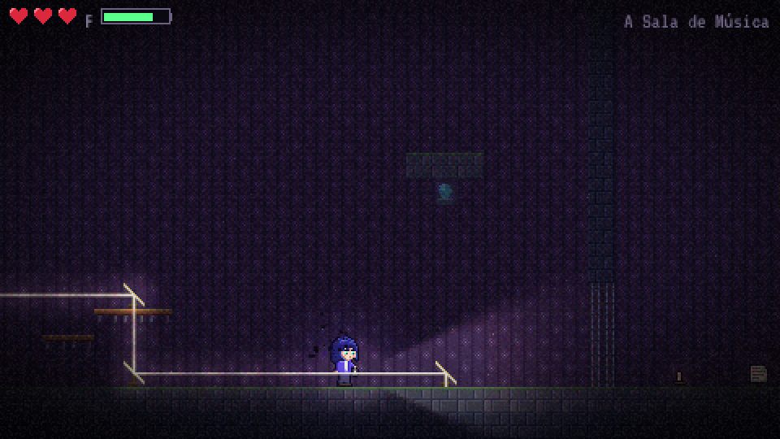
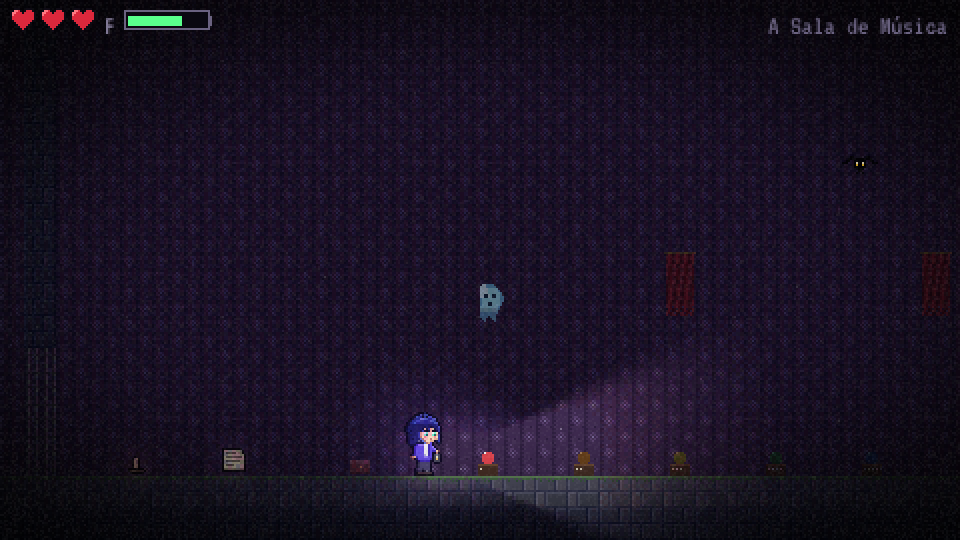
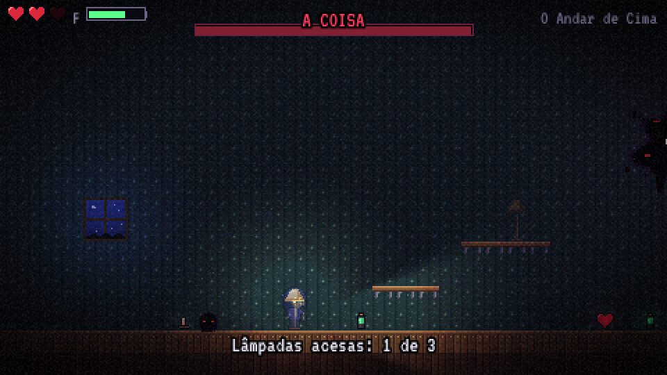

# INSONE

> Um jogo de plataforma e terror em pixel art, feito com **PixiJS**.



**▶ Jogue no navegador:** https://arthur-schultz.github.io/insone/

Trabalho final da disciplina de **Desenvolvimento de Jogos Digitais** da **UniAcademia**, com o **Prof. Msc. Christien Lana Rachid**. Fomos o **Grupo 20**, e a ferramenta definida para o grupo foi o **PixiJS**.

| Integrantes |
| --- |
| Arthur Schultz Marzaro |
| Augusto Brando Almeida |
| Eduardo de Oliveira Ferreira Filho |
| Pedro Lucas de Souza Caniato |

---

## Sumário

- [Enredo](#enredo)
- [Objetivos](#objetivos)
- [Como jogar](#como-jogar)
- [Mecânicas e puzzles](#mecânicas-e-puzzles)
- [Ferramenta utilizada: PixiJS](#ferramenta-utilizada-pixijs)
- [Instalação e execução](#instalação-e-execução)
- [Capturas de tela](#capturas-de-tela)
- [Estrutura do projeto](#estrutura-do-projeto)
- [Arte e som](#arte-e-som)
- [Créditos](#créditos)

---

## Enredo

Mais uma noite em que **Iris** não consegue dormir. Quando abre os olhos, ela não está no próprio quarto, e sim na **casa da avó**, abandonada há anos. O relógio da sala parou às **3:33**.

Os corredores estão tomados por **Sombras**, criaturas de olhos vermelhos que só se movem no escuro, e por **Vultos** que voam pelo teto e mergulham em quem estiver desprotegido. Nas janelas, alguém observa. Para se defender, Iris tem só uma **lanterna de pilha fraca**. Os bilhetes que a avó deixou espalhados pela casa explicam aos poucos o que está acontecendo, e Iris começa a entender que a insônia dela talvez não seja só falta de sono.

Para escapar, ela precisa atravessar cinco cômodos da casa, encontrar a lanterna de luz ultravioleta do avô, derrotar A Coisa e chegar ao antigo quarto para finalmente deitar na própria cama.

## Objetivos

- **Fase 1, O Térreo:** descobrir onde está a chave do corredor, dar um jeito de alcançá-la e abrir a porta trancada.
- **Fase 2, A Biblioteca:** encontrar a lanterna UV, atravessar um abismo de espinhos por plataformas invisíveis e descobrir, com a tinta invisível do avô, quais alavancas abrem a passagem.
- **Fase 3, O Porão:** decifrar a combinação de três alavancas, prender uma caixa na placa de pressão e cruzar os pilares antes que o portão com tempo se feche.
- **Fase 4, A Sala de Música:** girar espelhos para guiar um feixe de luz até um cristal e repetir nas pedras musicais a canção da caixinha de música.
- **Fase 5, O Andar de Cima:** achar a senha do cadeado (escrita com tinta invisível), fugir d'**A Coisa** pelo corredor e enfrentá-la na batalha final.
- **Sempre:** administrar a pilha da lanterna, não perder toda a **sanidade** (os 3 corações) e ler os 15 bilhetes para conhecer a história completa.

No fim, o jogo mostra o tempo total, quantas vezes a Iris caiu, quantos bilhetes foram lidos e quantas sombras foram dissolvidas. O melhor tempo fica salvo.

## Como jogar

| Tecla | Ação |
| --- | --- |
| `A` / `D` ou `←` / `→` | Andar |
| `W`, `ESPAÇO` ou `↑` | Pular (segure para ir mais alto) |
| `S` ou `↓` | Descer das prateleiras |
| `F` | Ligar / desligar a lanterna |
| `Q` | Alternar entre luz branca e ultravioleta (depois de encontrar a lanterna UV) |
| `E` ou `ENTER` | Interagir, ler bilhetes, avançar diálogos |
| `ESC` ou `P` | Pausar |
| `M` | Ligar / desligar o som |

## Mecânicas e puzzles

O jogo não explica as soluções: os bilhetes e as escritas invisíveis dão pistas, e o resto o jogador precisa descobrir.

**Luz**
- **Lanterna branca:** ilumina em cone, gasta pilha rápido e não atravessa paredes, portas nem portões.
- **Lanterna UV (tecla Q):** revela plataformas e escritas invisíveis e é a única luz que fere os fantasmas, mas gasta 60% mais pilha.
- **Velas e lâmpadas:** iluminam ao redor e afastam as criaturas. Só existe uma vela (checkpoint) por fase.

**Criaturas**
- **Sombras:** só andam no escuro. A luz as congela e, se ficar em cima delas, elas se dissolvem.
- **Vultos:** voam e mergulham na Iris. A luz não os mata, só os espanta.
- **Fantasmas:** atravessam paredes e não ligam para a luz branca. Só a luz UV os dissolve.
- **A Coisa:** persegue a Iris pelo corredor e depois vira a chefe final. Na arena, ela invoca sombras, e só fica vulnerável à luz UV depois que as 3 lâmpadas da avó são acesas.

**Puzzles**
- **Chave escondida** (fase 1): a etiqueta só diz que a chave fica "onde as crianças não alcançam", e a primeira prateleira é alta demais para alcançar pulando do chão.
- **Plataformas invisíveis** (fases 2 e 4): só aparecem sob a luz UV, mas continuam lá mesmo quando o jogador não as vê.
- **Alavancas marcadas** (fase 2): só a luz UV mostra quais alavancas são as certas.
- **Combinação de alavancas** (fase 3): a única pista é "a do meio sempre mente".
- **Caixa e placa de pressão** (fase 3): o portão do fundo só fica aberto com peso na placa, que está num buraco.
- **Alavanca com tempo** (fase 3): o portão fica aberto por 7 segundos, com tique-taque acelerando.
- **Espelhos e feixe de luz** (fase 4): um projetor dispara um feixe; girando os espelhos, o jogador o guia até o cristal. O feixe também queima as sombras no caminho.
- **Canção da caixinha** (fase 4): a caixinha toca uma melodia e acende as pedras na ordem. O jogador precisa repetir a sequência, enquanto um fantasma o persegue.
- **Senha invisível** (fase 5): os quatro números do cadeado estão escritos com tinta invisível pela casa.
- **Batalha final** (fase 5): acender as 3 lâmpadas fugindo d'A Coisa e das sombras invocadas, e depois mirar a luz UV nela até ela se desfazer.

**Também tem:** diálogos com os 5 retratos de expressão da Iris (a boca mexe e ela pisca), olhos que aparecem nas janelas e um coração que acelera quando há perigo por perto.

<details>
<summary><b>Spoiler: soluções dos puzzles</b></summary>

- **Fase 1, chave:** no alto das prateleiras da cozinha. Empurre a caixa até perto da primeira prateleira, suba nela e vá pulando pelas tábuas.
- **Fase 2, abismo:** com a luz UV, pule pelas plataformas que aparecem.
- **Fase 2, alavancas:** ligue as que têm um olho desenhado em cima (a 1ª e a 4ª).
- **Fase 3, alavancas:** a 1ª e a 3ª ligadas, a do meio desligada.
- **Fase 3, caixa:** empurre a caixa até ela cair no buraco com a placa.
- **Fase 3, portão com tempo:** dissolva a sombra do pilar antes de puxar a alavanca e corra pelos pilares.
- **Fase 4, espelhos:** os dois primeiros em `\` e o terceiro em `/`.
- **Fase 4, canção:** amarela, vermelha, azul, laranja, verde (pedras 3, 1, 5, 2, 4).
- **Fase 5, cadeado:** LUA 7, OLHO 1, VELA 9, CHAVE 4. A senha é **7194**.
- **Fase 5, chefe:** acenda as 3 lâmpadas (uma no chão à esquerda, uma na prateleira alta e uma no chão à direita) e depois segure a luz UV n'A Coisa.

</details>

<details>
<summary><b>Atalho para a apresentação</b></summary>

Durante o jogo, digite `insone` no teclado para pular para a próxima fase.

</details>

## Ferramenta utilizada: PixiJS

O jogo foi feito com o **[PixiJS v8](https://pixijs.com/)**, uma engine de renderização 2D em WebGL para HTML5. Recursos do PixiJS usados no projeto:

| Recurso | Uso no jogo |
| --- | --- |
| `Application` e `Ticker` | Inicializa o renderizador WebGL e executa o game loop a cada quadro |
| `Assets` | Carrega os spritesheets antes de o jogo começar |
| `Texture` + `Rectangle` | Recortam os spritesheets em quadros (Iris, sombras, A Coisa, tiles, retratos) |
| `Sprite` | Personagens, objetos, itens e cenário |
| `TilingSprite` | Papel de parede das fases, portões de ferro que sobem e efeito de granulado |
| `Container` | Organiza o jogo em camadas (cenário, objetos, entidades, partículas, interface) e a câmera |
| `RenderTexture` + `blendMode` | **Sistema de iluminação**: as luzes são desenhadas com `add` numa textura de luz, que é aplicada sobre o mundo com `multiply` |
| `Graphics` | Caixas de diálogo, HUD, barra de pilha, barra do chefe, feixe de luz, transições e flashes de dano |
| `Filter` + `GlProgram` | Shader GLSL próprio que aplica pontilhado (dithering Bayer 4×4) na luz, para a iluminação ficar com cara de pixel art |
| `Text` + `TextStyle` + `CanvasTextMetrics` | Textos com fonte pixel e quebra de linha do efeito "máquina de escrever" |
| `TextureSource.defaultOptions.scaleMode = 'nearest'` | Mantém a pixel art nítida quando a tela é ampliada |

O jogo roda em resolução interna de **480×270**, ampliada para o tamanho da janela sem borrar os pixels.

### Técnicas de pixel art e de iluminação

- **Paletas com hue shifting:** as sombras puxam para o roxo e as luzes para o ciano, em vez de só escurecer ou clarear a mesma cor.
- **Contorno seletivo:** cada parte da Iris tem um contorno da própria cor mais escura (pele, cabelo, roupa), em vez de preto puro em tudo.
- **Paleta limitada:** cerca de 16 cores por sprite.
- **Cenário com luz e sombra em cada peça:** tijolos, tábuas e pedras com borda clara em cima e escura embaixo, musgo no porão e papel de parede com estampa.
- **Luz quantizada com dithering:** a luz é reduzida a poucos níveis e misturada com um padrão de pontos, como nos jogos de 16 bits, em vez de um degradê liso.

Além do PixiJS, o projeto usa:

- **[Vite](https://vite.dev/)** como servidor de desenvolvimento e para gerar a versão final
- **Web Audio API** (nativa do navegador) para gerar toda a trilha e os efeitos sonoros
- **[@fontsource/vt323](https://fontsource.org/fonts/vt323)** para a fonte pixel

## Instalação e execução

### Jogar sem instalar nada

Acesse **https://arthur-schultz.github.io/insone/** num navegador moderno (Chrome, Edge ou Firefox) e use o teclado.

### Rodar o código no computador

Pré-requisitos: **[Node.js](https://nodejs.org/) 18 ou mais recente** (o npm já vem junto) e **Git**.

```bash
git clone https://github.com/Arthur-Schultz/insone.git
cd insone
npm install
npm run dev
```

Depois, abra o endereço que aparecer no terminal (normalmente `http://localhost:5173`).

### Gerar a versão final (build)

```bash
npm run build
npm run preview
```

A versão otimizada fica na pasta `dist/`. Toda vez que algo é enviado para a branch `main`, o workflow `.github/workflows/deploy.yml` publica o jogo automaticamente no GitHub Pages.

### Dependências

| Pacote | Tipo | Para quê |
| --- | --- | --- |
| `pixi.js` ^8 | dependência | Engine de renderização 2D |
| `@fontsource/vt323` ^5 | dependência | Fonte pixel VT323 |
| `vite` ^8 | desenvolvimento | Servidor local e build |

## Capturas de tela

| | |
| --- | --- |
|  |  |
| **Tela de título** | **Diálogos com os retratos da Iris** |
|  |  |
| **A lanterna no térreo** | **Prateleiras da cozinha e a chave** |
|  |  |
| **A luz UV revelando plataformas e um fantasma** | **Escritas invisíveis nas alavancas** |
|  |  |
| **O porão: caixa e placa de pressão** | **Espelhos guiando o feixe até o cristal** |
|  |  |
| **As pedras musicais** | **Procurando a senha com a luz UV** |
|  | |
| **A batalha contra A Coisa** | |

## Estrutura do projeto

```text
insone/
├── index.html                 página que carrega o jogo
├── package.json               dependências e scripts (dev, build, preview)
├── vite.config.js
├── public/assets/             spritesheets e ícone usados pelo jogo
├── arte/retratos/             retratos originais da Iris (1024×1024)
├── docs/                      capturas e GIF do README
├── .github/workflows/         deploy automático no GitHub Pages
└── src/
    ├── main.js                inicia o PixiJS, o game loop e a troca de cenas
    ├── config.js              resolução, física e constantes
    ├── core/                  recursos (texturas), entrada, som e progresso salvo
    ├── cenas/                 título, jogo e final
    ├── jogo/                  fase, física, Iris, sombras, vultos, fantasmas, A Coisa, chefe, objetos, luz, partículas
    ├── ui/                    diálogo, HUD, menus e painel do código
    └── dados/fases.js         mapas das 5 fases, falas, bilhetes, escritas e eventos
```

As fases são desenhadas como **mapas de texto** em `src/dados/fases.js`. Cada caractere vira um elemento do jogo: `#` é parede, `S` é sombra, `C` é caixa, `K` é chave, `N` é bilhete e assim por diante. A legenda completa está no início do arquivo.

## Arte e som

- **Iris:** a personagem e os 5 retratos de expressão são pixel art original do grupo (`arte/retratos`). O sprite que anda e pula, em estilo chibi, foi desenhado com base neles.
- **Cenário, criaturas e objetos:** pixel art feita pelo grupo para o jogo.
- **Som:** não usamos nenhum arquivo de áudio. A trilha (caixinha de música, drone ambiente, pulsação da perseguição, batimento cardíaco) e todos os efeitos sonoros são sintetizados em tempo real com a Web Audio API.

## Créditos

**Grupo 20:** Arthur Schultz Marzaro, Augusto Brando Almeida, Eduardo de Oliveira Ferreira Filho e Pedro Lucas de Souza Caniato.

**Orientação:** Prof. Msc. Christien Lana Rachid, UniAcademia.

**Fonte:** VT323, de Peter Hull, sob a SIL Open Font License.
