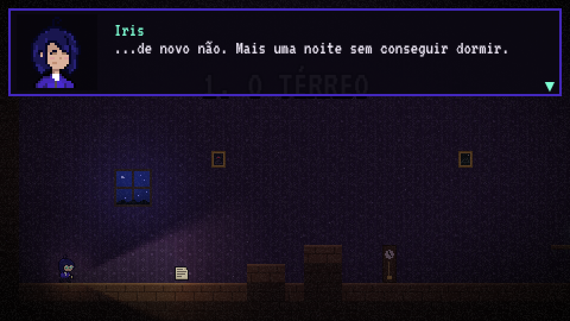
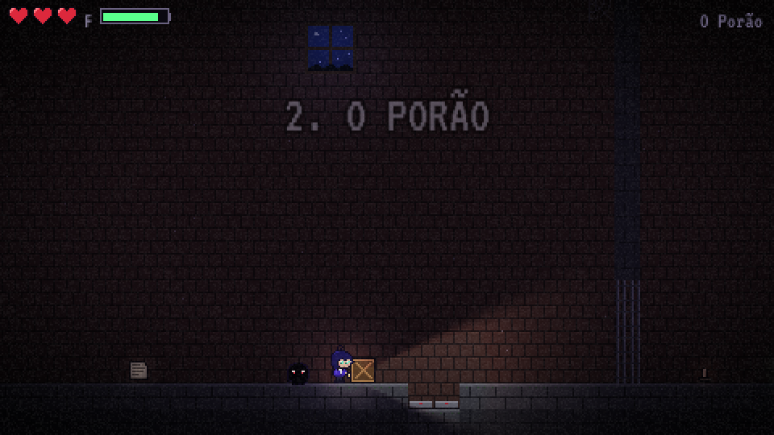
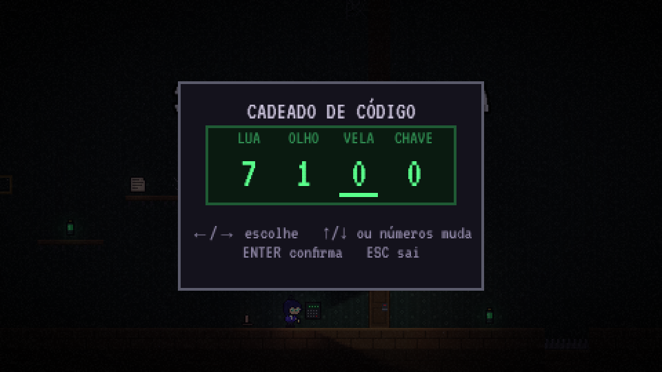
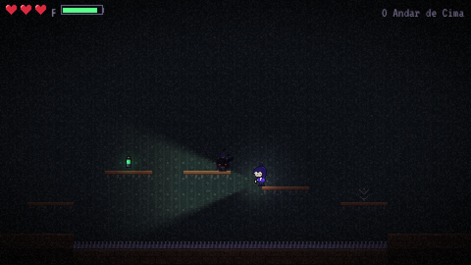
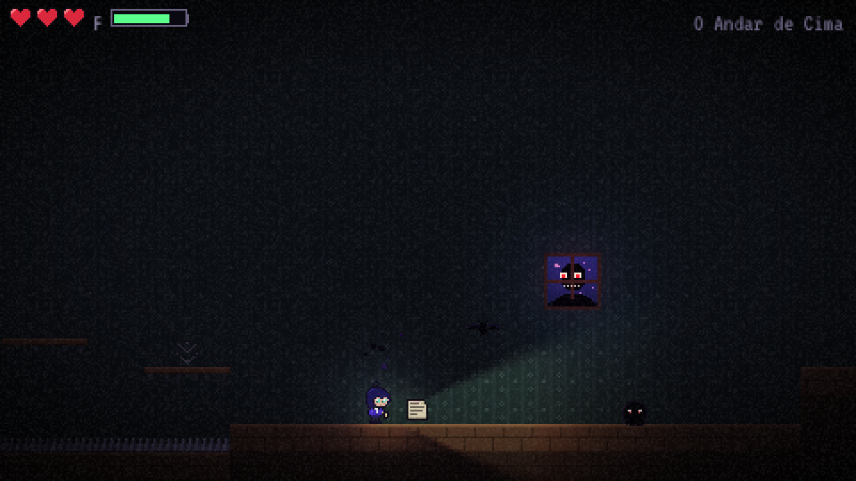
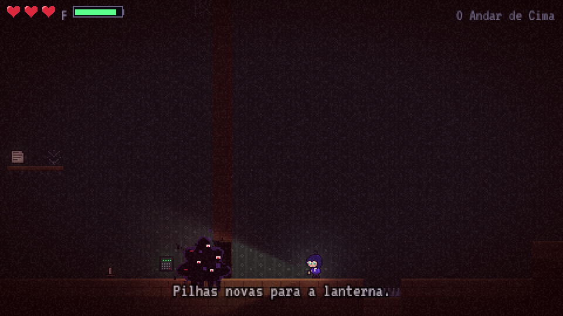

# INSONE

> Um jogo de plataforma e terror em pixel art, feito com **PixiJS**.


**▶ Jogue no navegador:** https://arthur-schultz.github.io/insone/

Trabalho final da disciplina de **Desenvolvimento de Jogos Digitais** da **UniAcademia**, com o **Prof. Msc. Christien Lana Rachid**. Fomos o **Grupo 20**, e a ferramenta definida para o grupo foi o **PixiJS**.

| Integrantes |
| --- |
| Arthur Schultz Marzaro |
| Augusto Brando Almeida |
| Eduardo de Oliveira Ferreira Filho |
| Pedro Lucas de Souza Caniato |

---

## Sumário

- [Enredo](#enredo)
- [Objetivos](#objetivos)
- [Como jogar](#como-jogar)
- [Mecânicas e puzzles](#mecânicas-e-puzzles)
- [Ferramenta utilizada: PixiJS](#ferramenta-utilizada-pixijs)
- [Instalação e execução](#instalação-e-execução)
- [Capturas de tela](#capturas-de-tela)
- [Estrutura do projeto](#estrutura-do-projeto)
- [Arte e som](#arte-e-som)
- [Créditos](#créditos)

---

## Enredo

Mais uma noite em que **Iris** não consegue dormir. Quando abre os olhos, ela não está no próprio quarto, e sim na **casa da avó**, abandonada há anos. O relógio da sala parou às **3:33**.

Os corredores estão tomados por **Sombras**, criaturas de olhos vermelhos que só se movem no escuro, e por **Vultos** que voam pelo teto e mergulham em quem estiver desprotegido. Nas janelas, alguém observa. Para se defender, Iris tem só uma **lanterna de pilha fraca**. Os bilhetes que a avó deixou espalhados pela casa explicam aos poucos o que está acontecendo, e Iris começa a entender que a insônia dela talvez não seja só falta de sono.

Para escapar, ela precisa atravessar três andares da casa até chegar ao antigo quarto e finalmente deitar na própria cama.

## Objetivos

- **Fase 1, O Térreo:** descobrir onde está a chave do corredor e abrir a porta trancada.
- **Fase 2, O Porão:** decifrar a combinação certa de três alavancas e dar um jeito de manter aberto o portão do fundo.
- **Fase 3, O Andar de Cima:** encontrar a senha do cadeado, que está espalhada pela casa, e fugir d'**A Coisa** até o quarto.
- **Sempre:** manter a lanterna com pilha, não perder toda a **sanidade** (os 3 corações) e ler os 9 bilhetes para conhecer a história completa.

No fim, o jogo mostra o tempo total, quantas vezes a Iris caiu, quantos bilhetes foram lidos e quantas sombras foram dissolvidas. O melhor tempo fica salvo.

## Como jogar

| Tecla | Ação |
| --- | --- |
| `A` / `D` ou `←` / `→` | Andar |
| `W`, `ESPAÇO` ou `↑` | Pular (segure para ir mais alto) |
| `S` ou `↓` | Descer das prateleiras |
| `F` | Ligar / desligar a lanterna |
| `E` ou `ENTER` | Interagir, ler bilhetes, avançar diálogos |
| `ESC` ou `P` | Pausar |
| `M` | Ligar / desligar o som |

## Mecânicas e puzzles

O jogo não explica as soluções: os bilhetes dão pistas, e o resto o jogador precisa descobrir.

- **Lanterna e luz:** a lanterna ilumina em cone na direção em que a Iris olha e gasta pilha rápido (uma carga cheia dura menos de 30 segundos). Quando a carga fica fraca, ela começa a piscar. As pilhas são poucas, então às vezes vale a pena andar no escuro.
- **Sombras:** só se movem no escuro e perseguem a Iris quando ela chega perto. A luz as congela, e se ficar em cima delas por tempo suficiente, elas se dissolvem.
- **Vultos (inimigo voador):** pairam perto do teto e mergulham na direção da Iris. Não morrem com a luz, mas fogem quando são iluminados, então é preciso virar e mirar a lanterna na hora certa.
- **Olhos na janela:** às vezes uma silhueta de olhos vermelhos aparece nas janelas, com um sussurro, e some quando a Iris se aproxima.
- **Sanidade:** 3 corações. Encostar em sombras ou vultos, cair em espinhos ou ser alcançada por A Coisa tira 1 coração. Se acabarem, a Iris volta para a última vela acesa.
- **Velas (checkpoints):** só existe **uma vela por fase**. Até encontrá-la, cada erro manda a Iris de volta para o começo.
- **Chave e porta trancada** (fase 1): a etiqueta na gaveta só diz que a chave fica "onde as crianças não alcançam".
- **Alavancas** (fase 2): três alavancas que podem ser ligadas e desligadas. O portão só abre na combinação certa, e a única pista é um bilhete enigmático do avô.
- **Caixa e placa de pressão** (fase 2): o portão do fundo só fica aberto enquanto há peso na placa, que fica dentro de um buraco no chão.
- **Cadeado com símbolos** (fase 3): o painel pede 4 números na ordem LUA, OLHO, VELA, CHAVE. Cada número está riscado numa parede da casa, em lugares escuros, altos ou protegidos por sombras.
- **Luz e paredes:** a luz da lanterna e das velas não atravessa paredes, portas fechadas nem portões. O cone para no primeiro obstáculo.
- **Perseguição final** (fase 3): A Coisa persegue a Iris pelo corredor e fica mais rápida a cada segundo. Se alcançar a Iris, é game over na hora. Apontar a lanterna para ela só a deixa um pouco mais lenta. No meio do caminho, um portão só abre com uma alavanca, e é preciso puxá-la sem parar de fugir.
- **Diálogos com retratos:** cada fala usa a expressão da Iris que combina com o momento (neutra, falando, olhos fechados, assustada, gritando). A boca mexe enquanto o texto aparece e ela pisca de vez em quando.
- **Sustos:** olhos aparecem nas janelas, e o coração acelera quando há perigo por perto.

<details>
<summary><b>Spoiler: soluções dos puzzles</b></summary>

- **Chave (fase 1):** no alto das prateleiras da cozinha. É preciso subir pelas tábuas.
- **Alavancas (fase 2):** a primeira e a terceira ligadas, e a do meio desligada.
- **Caixa (fase 2):** empurre a caixa até ela cair no buraco com a placa de pressão.
- **Cadeado (fase 3):** LUA 7, OLHO 1, VELA 9, CHAVE 4. A senha é **7194**.
- **Perseguição (fase 3):** suba no bloco, puxe a alavanca que está em cima dele e corra para o portão enquanto ele sobe.

</details>

<details>
<summary><b>Atalho para a apresentação</b></summary>

Durante o jogo, digite `insone` no teclado para pular para a próxima fase.

</details>

## Ferramenta utilizada: PixiJS

O jogo foi feito com o **[PixiJS v8](https://pixijs.com/)**, uma engine de renderização 2D em WebGL para HTML5. Recursos do PixiJS usados no projeto:

| Recurso | Uso no jogo |
| --- | --- |
| `Application` e `Ticker` | Inicializa o renderizador WebGL e executa o game loop a cada quadro |
| `Assets` | Carrega os spritesheets antes de o jogo começar |
| `Texture` + `Rectangle` | Recortam os spritesheets em quadros (Iris, sombras, A Coisa, tiles, retratos) |
| `Sprite` | Personagens, objetos, itens e cenário |
| `TilingSprite` | Papel de parede das fases, portões de ferro que sobem e efeito de granulado |
| `Container` | Organiza o jogo em camadas (cenário, objetos, entidades, partículas, interface) e a câmera |
| `RenderTexture` + `blendMode` | **Sistema de iluminação**: as luzes são desenhadas com `add` numa textura de luz, que é aplicada sobre o mundo com `multiply` |
| `Graphics` | Caixas de diálogo, HUD, barra de pilha, transições e flashes de dano |
| `Text` + `TextStyle` + `CanvasTextMetrics` | Textos com fonte pixel e quebra de linha do efeito "máquina de escrever" |
| `TextureSource.defaultOptions.scaleMode = 'nearest'` | Mantém a pixel art nítida quando a tela é ampliada |

O jogo roda em resolução interna de **480×270**, ampliada para o tamanho da janela sem borrar os pixels.

Além do PixiJS, o projeto usa:

- **[Vite](https://vite.dev/)** como servidor de desenvolvimento e para gerar a versão final
- **Web Audio API** (nativa do navegador) para gerar toda a trilha e os efeitos sonoros
- **[@fontsource/vt323](https://fontsource.org/fonts/vt323)** para a fonte pixel

## Instalação e execução

### Jogar sem instalar nada

Acesse **https://arthur-schultz.github.io/insone/** num navegador moderno (Chrome, Edge ou Firefox) e use o teclado.

### Rodar o código no computador

Pré-requisitos: **[Node.js](https://nodejs.org/) 18 ou mais recente** (o npm já vem junto) e **Git**.

```bash
git clone https://github.com/Arthur-Schultz/insone.git
cd insone
npm install
npm run dev
```

Depois, abra o endereço que aparecer no terminal (normalmente `http://localhost:5173`).

### Gerar a versão final (build)

```bash
npm run build
npm run preview
```

A versão otimizada fica na pasta `dist/`. Toda vez que algo é enviado para a branch `main`, o workflow `.github/workflows/deploy.yml` publica o jogo automaticamente no GitHub Pages.

### Dependências

| Pacote | Tipo | Para quê |
| --- | --- | --- |
| `pixi.js` ^8 | dependência | Engine de renderização 2D |
| `@fontsource/vt323` ^5 | dependência | Fonte pixel VT323 |
| `vite` ^8 | desenvolvimento | Servidor local e build |

## Capturas de tela

| | |
| --- | --- |
|  |  |
| **Tela de título** | **Diálogos com os retratos da Iris** |
|  |  |
| **A lanterna paralisando uma sombra** | **Prateleiras da cozinha e a chave** |
|  |  |
| **O porão: caixa e placa de pressão** | **O cadeado de código** |
|  |  |
| **Procurando as marcas da senha** | **Olhos na janela** |
|  | |
| **A Coisa** | |

## Estrutura do projeto

```text
insone/
├── index.html                 página que carrega o jogo
├── package.json               dependências e scripts (dev, build, preview)
├── vite.config.js
├── public/assets/             spritesheets e ícone usados pelo jogo
├── arte/retratos/             retratos originais da Iris (1024×1024)
├── docs/                      capturas e GIF do README
├── .github/workflows/         deploy automático no GitHub Pages
└── src/
    ├── main.js                inicia o PixiJS, o game loop e a troca de cenas
    ├── config.js              resolução, física e constantes
    ├── core/                  recursos (texturas), entrada, som e progresso salvo
    ├── cenas/                 título, jogo e final
    ├── jogo/                  fase, física, Iris, sombras, vultos, A Coisa, objetos, luz, partículas
    ├── ui/                    diálogo, HUD, menus e painel do código
    └── dados/fases.js         mapas das 3 fases, falas, bilhetes e eventos
```

As fases são desenhadas como **mapas de texto** em `src/dados/fases.js`. Cada caractere vira um elemento do jogo: `#` é parede, `S` é sombra, `C` é caixa, `K` é chave, `N` é bilhete e assim por diante. A legenda completa está no início do arquivo.

## Arte e som

- **Iris:** a personagem e os 5 retratos de expressão são pixel art original do grupo (`arte/retratos`). O sprite que anda e pula, em estilo chibi, foi desenhado com base neles.
- **Cenário, sombras, vultos, A Coisa e objetos:** pixel art feita pelo grupo para o jogo.
- **Som:** não usamos nenhum arquivo de áudio. A trilha (caixinha de música, drone ambiente, pulsação da perseguição, batimento cardíaco) e todos os efeitos sonoros são sintetizados em tempo real com a Web Audio API.

## Créditos

**Grupo 20:** Arthur Schultz Marzaro, Augusto Brando Almeida, Eduardo de Oliveira Ferreira Filho e Pedro Lucas de Souza Caniato.

**Orientação:** Prof. Msc. Christien Lana Rachid, UniAcademia.

**Fonte:** VT323, de Peter Hull, sob a SIL Open Font License.
